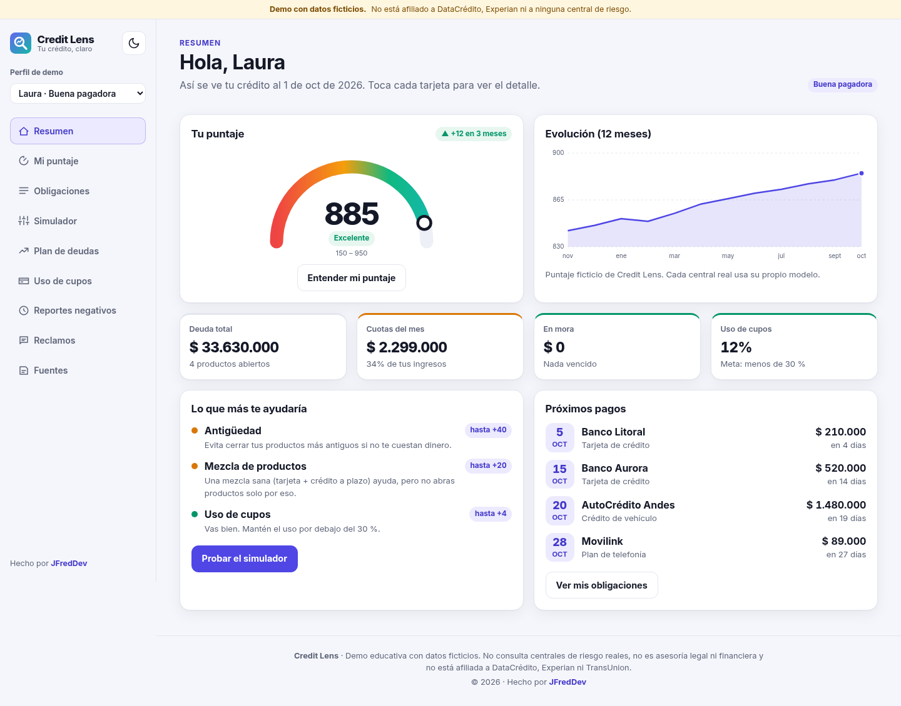
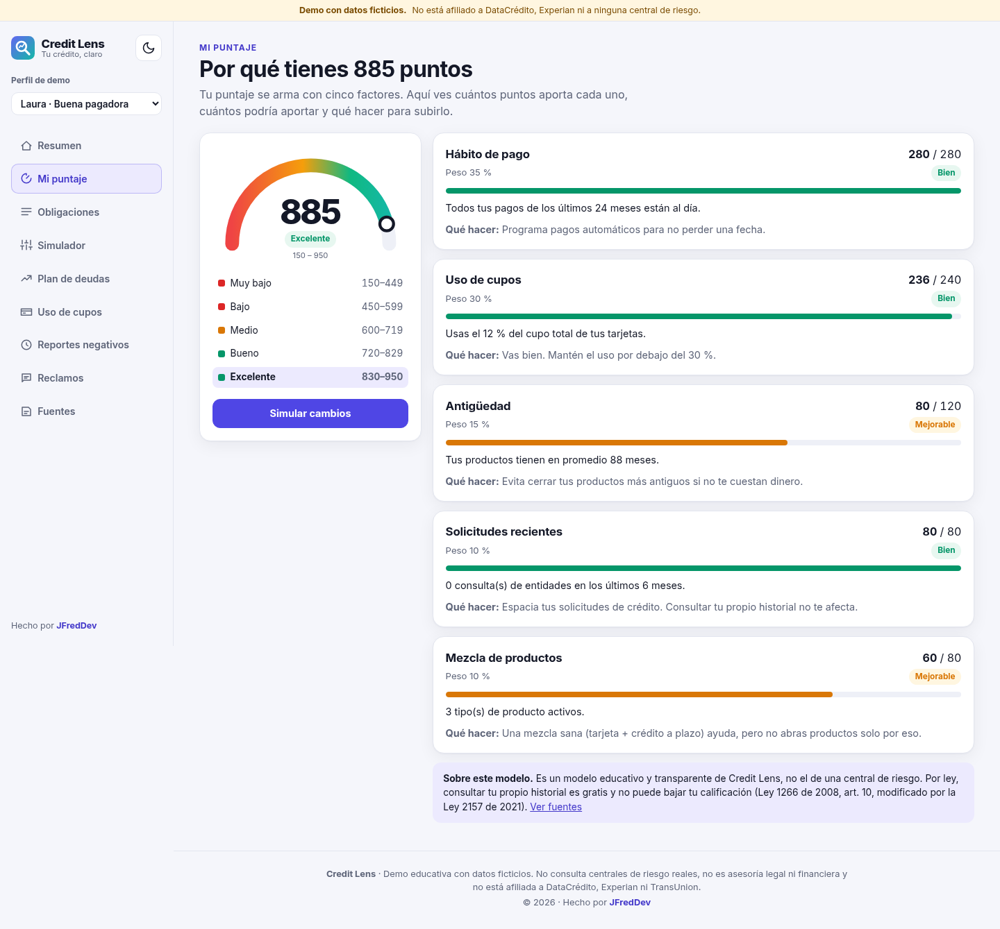
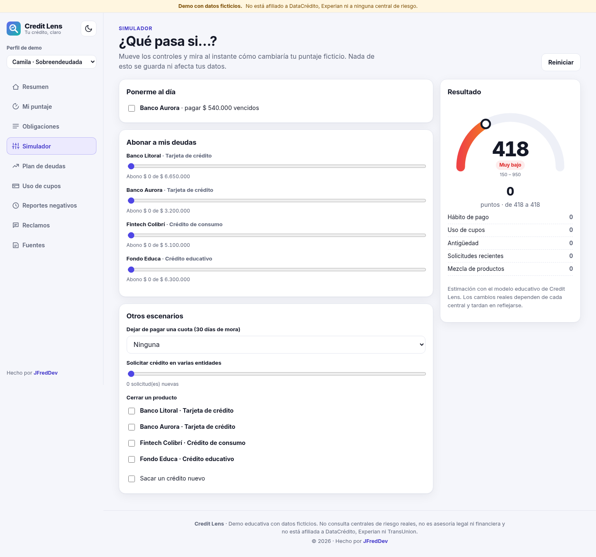
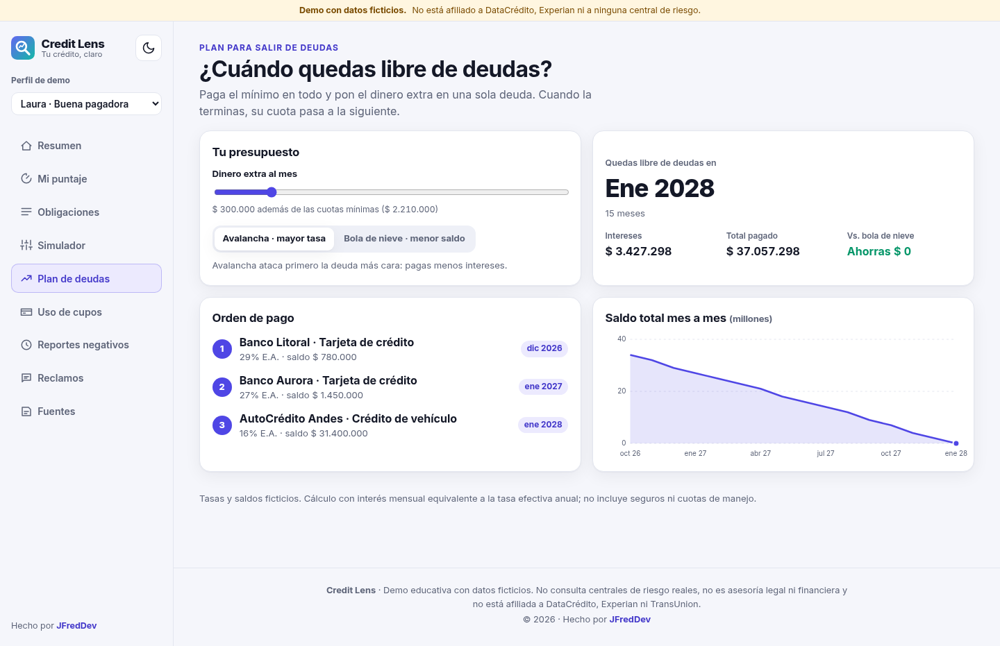
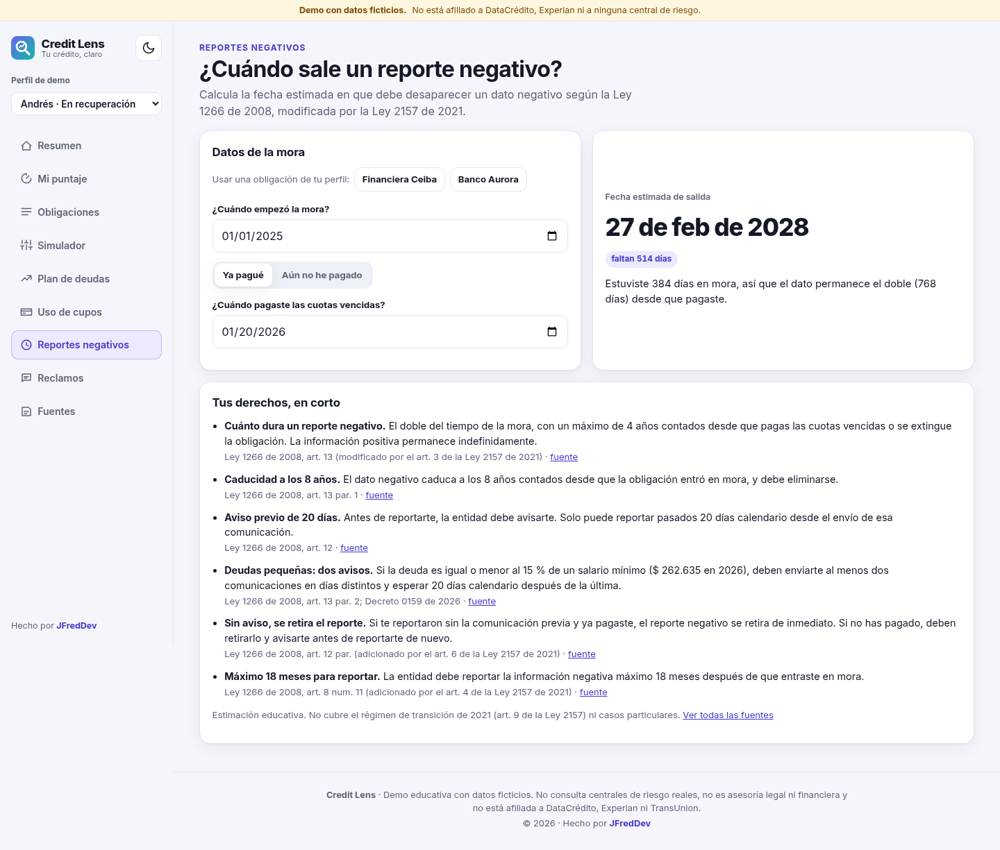
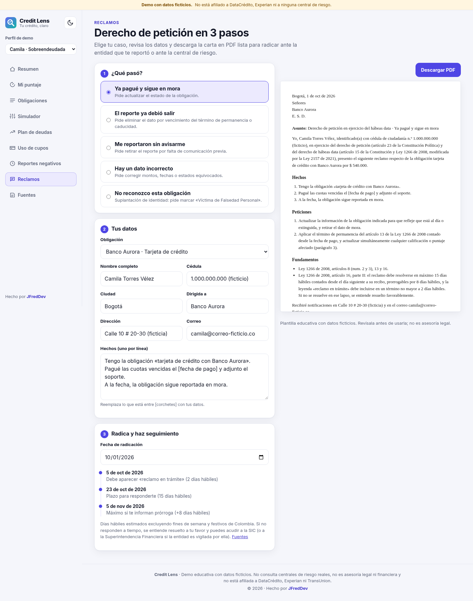
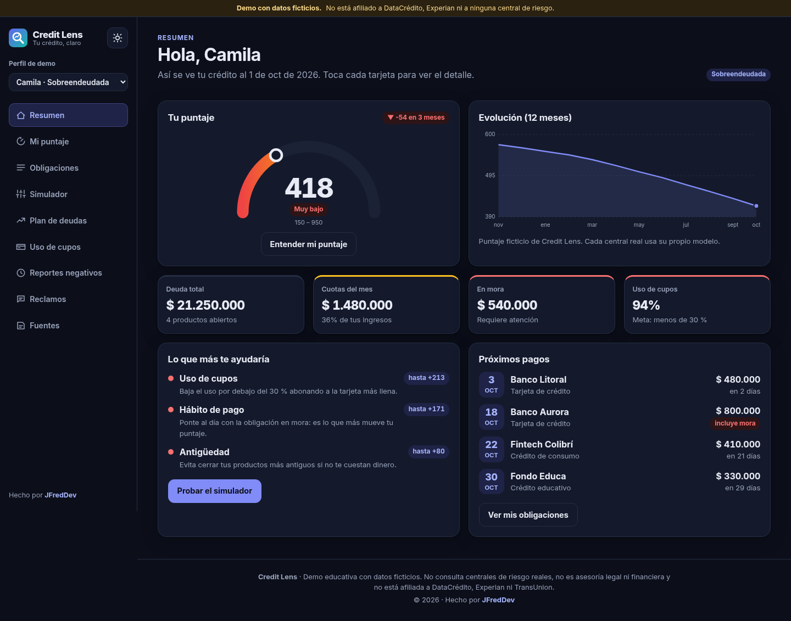

<p align="center"></p>
<h1 align="center">Credit Lens</h1>
<p align="center"><b>Tu crédito, claro.</b><br />Un centro de crédito personal para Colombia: entender tu historial, no solo verlo.</p>
<p align="center"><a href="https://jfredmc.github.io/credit-lens/"><b>Ver la demo</b></a></p>

> **Demo con datos ficticios.** No consulta centrales de riesgo reales, no hace scraping y no está afiliado a DataCrédito, Experian, TransUnion ni a ninguna entidad financiera. El puntaje es un modelo educativo propio. No es asesoría legal ni financiera.



## Qué incluye

| Pantalla               | Qué resuelve                                                                                                                                         |
| ---------------------- | ---------------------------------------------------------------------------------------------------------------------------------------------------- |
| **Resumen**            | Puntaje 150–950 con evolución de 12 meses, deuda, cuotas vs. ingresos, mora, uso de cupos, las 3 acciones que más suben el puntaje y próximos pagos. |
| **Mi puntaje**         | Cinco factores con puntos obtenidos vs. posibles, estado y «qué hacer» para cada uno.                                                                |
| **Obligaciones**       | Productos con hábito de pago de 24 meses, filtros y detalle por obligación.                                                                          |
| **Simulador**          | «¿Qué pasa si…?»: abonar, ponerse al día, dejar de pagar, pedir crédito, cerrar un producto. Resultado al instante.                                  |
| **Plan de deudas**     | Avalancha vs. bola de nieve con dinero extra: fecha de libertad, intereses, ahorro y orden de pago.                                                  |
| **Uso de cupos**       | Uso total y por tarjeta con meta del 30 % y cuánto abonar para llegar.                                                                               |
| **Reportes negativos** | Fecha estimada de salida de un dato negativo (Ley 1266 de 2008, mod. Ley 2157 de 2021).                                                              |
| **Reclamos**           | Derecho de petición en 3 pasos, vista previa y PDF; seguimiento de plazos en días hábiles con festivos de Colombia.                                  |
| **Alertas**            | Centro de alertas ficticias (consultas nuevas, riesgo de mora, uso de cupos sobre un umbral, cambios en el reporte) con filtros y leídas/no leídas.  |
| **Huella de consulta** | Quién consultó tu historial, cuáles cuentan para el puntaje y por qué tus propias consultas no te afectan.                                           |
| **Calendario**         | Calendario mensual de cuotas con exportación a .ics (Google Calendar, Outlook, iPhone) y recordatorio 2 días antes.                                  |
| **Metas**              | Metas sugeridas (subir de banda, uso ≤ 30 %, ponerse al día) con progreso, fecha objetivo y metas propias.                                           |
| **Exportar reporte**   | Reporte completo en PDF, Excel y Word, y tarjeta para compartir sin datos personales. Las librerías se cargan solo al exportar.                      |
| **Aprende**            | Lecciones cortas, mitos frecuentes y conversor de tasa E.A. a mensual con la usura vigente, cada uno con su norma.                                   |
| **Fuentes**            | Cada regla legal con su artículo y enlace oficial.                                                                                                   |

Tres perfiles ficticios (buena pagadora, en recuperación, sobreendeudada), tema claro/oscuro y diseño responsive desde 360 px.

## Reglas legales verificadas

Verificadas el 14 de octubre de 2026 contra los textos oficiales ([Senado: Ley 1266](http://www.secretariasenado.gov.co/senado/basedoc/ley_1266_2008.html), [Senado: Ley 2157](http://www.secretariasenado.gov.co/senado/basedoc/ley_2157_2021.html), [Función Pública](https://www.funcionpublica.gov.co/eva/gestornormativo/norma.php?i=34488), [SIC](https://www.sic.gov.co/sobre-el-habeas-data-financiero)). Están centralizadas en [`src/app/domain/legal.ts`](src/app/domain/legal.ts):

- Consulta del titular gratuita siempre y por todos los medios (art. 10 par. 2).
- Permanencia: doble del tiempo de mora, máximo 4 años desde el pago; caducidad a los 8 años desde el inicio de la mora (art. 13).
- Aviso previo: 20 días calendario (art. 12); deudas ≤ 15 % del SMMLV ($ 262.635 en 2026): dos avisos en días distintos (art. 13 par. 2).
- Reclamos: 15 días hábiles (+8), «reclamo en trámite» en 2 días hábiles, silencio a favor del titular (art. 16 II); consultas: 10 (+5) días hábiles.
- Alerta gratuita por obligaciones nuevas en 5 días hábiles (Ley 2157, art. 10); suplantación: cotejo en 10 días y leyenda «Víctima de Falsedad Personal» (art. 16 II num. 7).
- Usura de octubre de 2026 para consumo y ordinario: 28,59 % E.A. ([Superfinanciera, Res. 1472 de 2026](https://www.superfinanciera.gov.co/publicaciones/10116267/superfinanciera-certifica-el-interes-bancario-corriente/)).

## Stack

Angular 22 (standalone, zoneless, signals, OnPush) · TypeScript · CSS propio · jsPDF · docx · write-excel-file · Vitest · Playwright (escritorio + móvil) · ESLint · Prettier · pnpm · GitHub Actions + GitHub Pages.

La lógica (puntaje, simulador, plan de deudas, permanencia, días hábiles, carta) vive en funciones puras en `src/app/domain` con pruebas unitarias.

```bash
pnpm install
pnpm start          # http://localhost:4200
pnpm test           # Vitest
pnpm build:pages && pnpm e2e   # Playwright contra el build de Pages
```

## Capturas

|                                                             |                                                                 |
| ----------------------------------------------------------- | --------------------------------------------------------------- |
|          |             |
|  |  |
|           |        |

## Próximas fases

Backend opcional (NestJS + Postgres) para guardar metas y alertas entre dispositivos. Ver [`docs/PLAN.md`](docs/PLAN.md).

---

Hecho por [JFredDev](https://jfredmc.github.io/portfolio/) · Licencia MIT
